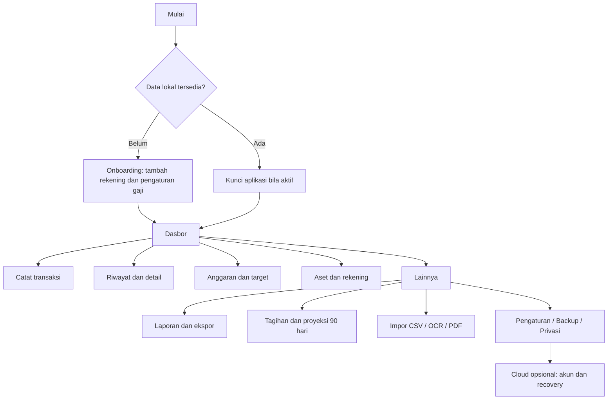

# FinTrack — peta layar dan handoff Designer

Tanggal: 31 Oktober 2026. Ini adalah spesifikasi alur dan cakupan desain, bukan klaim bahwa seluruh layar sudah diimplementasikan. ZIP berisi 32 `code.html`; berkas `screen.png` masing-masing 28 byte tidak dapat dipakai sebagai preview normal. Referensi utama adalah HTML, token dalam `sovereign_slate/DESIGN.md` dan perilaku dalam dokumentasi FinTrack.

## Navigasi yang diusulkan

Bottom navigation: Dasbor, Riwayat, Anggaran, Aset, Lainnya. Tombol Catat menjadi aksi utama konsisten. Laporan, tagihan dan target dapat diberi pintasan dari dasbor tanpa menambah tab utama. Back dari modal kembali ke layar asal dengan draft dipertahankan; keluar dari form berubah meminta keputusan simpan draft/buang. Lima tab adalah keputusan usulan, perlu uji navigasi singkat bersama pengguna sasaran.

## Keputusan sistem visual

`DESIGN.md` tidak konsisten: front matter memakai navy `#0B1326` dan card `#171F33`, sedangkan prose memakai slate `#0F172A`/`#1E293B`. Gunakan front matter yang juga cocok dengan dokumentasi FinTrack sebagai baseline. Jangan mencampur dua set token per layar.

| Token | Nilai usulan | Pemakaian |
|---|---|---|
| Background | `#0B1326` | Kanvas layar |
| Surface | `#171F33` | Kartu dan form |
| Elevated | `#222A3D` | Sheet/dialog |
| Primary action | `#2563EB` | Tombol dan kartu saldo |
| Positive | `#4EDEA3` | Pemasukan/progres positif, disertai label/ikon |
| Error/outflow | `#FFB4AB` | Pesan error dan nilai keluar; jangan mengandalkan warna saja |
| Main text | `#DAE2FD` | Teks utama |
| Secondary text | `#C3C6D7` | Keterangan dan label |
| Heading | Plus Jakarta Sans | Judul 18–28 sp; font dibundel sesuai lisensi |
| Body/angka | Inter | Body 14–16 sp; angka tabular; fallback font sistem diuji |
| Grid | 4/8 dp | Margin dasar 20 dp, jarak 8/16/24 dp |
| Shape | 16 dp card, 8 dp field | Konsisten di Compose dan mockup |
| Touch target | Minimum 48 dp | Tombol, ikon, chip interaktif |

Nilai CSS px/rem pada HTML diterjemahkan ke dp/sp Android; tidak disalin mekanis. Kontras setiap pasangan token harus diukur, terutama teks kecil di tombol biru. Grafik memiliki alternatif teks/tabel. Nominal besar boleh wrap atau menyesuaikan tata letak tanpa mengecil menjadi tak terbaca. Desain diuji pada font besar, keyboard terbuka, layar kecil dan TalkBack.

Gaya visual tidak membuktikan keamanan. Label “AES-256”, “bank terhubung”, “terverifikasi” atau “biometrik aktif” hanya muncul bila status aktual mendukungnya. Nama dan saldo contoh hanya untuk prototipe, diberi label “data contoh”.

## Pemetaan seluruh 32 referensi ZIP

Nama sumber di bawah adalah nama direktori persis; setiap direktori berisi `code.html`. `M2 opsional` tidak menghalangi MVP. Tampilan yang belum didukung harus disembunyikan dari navigasi rilis atau diberi label rencana tanpa tombol seolah berfungsi.

| ID | Direktori sumber | Layar/aksi dan alur | Fase dan keadaan wajib |
|---|---|---|---|
| S01 | `dasbor_fintrack` | Dasbor: saldo likuid, income/expense, catat cepat, anggaran dan riwayat | M1; kosong, terisi, nominal tersembunyi, defisit |
| S02 | `catat_transaksi_fintrack` | Form pemasukan/pengeluaran → validasi → simpan → detail | M1; belum ada rekening, nominal salah, menyimpan, gagal, sukses |
| S03 | `aset_tabungan_rekening_fintrack` | Aset: rekening, holding dan target → detail masing-masing | M1; kosong, data ada, harga manual/lama |
| S04 | `tambah_atur_rekening_e_wallet_fintrack` | Buat/edit rekening → nama/jenis/saldo awal/likuid | M1; nilai invalid, rekening bersejarah, arsip |
| S05 | `edit_profil_fintrack_e_wallet_utama` | Pengaturan profil lokal dan rekening default | M1 profil lokal; cloud M3; tanpa klaim akun bank terhubung |
| S06 | `perencanaan_batas_anggaran_fintrack` | Daftar anggaran → atur batas → detail pengeluaran kategori | M1; belum ada anggaran, normal, 80%, 100%, kelebihan |
| S07 | `modal_atur_batas_anggaran_fintrack` | Sheet nominal kategori → simpan/ganti/hapus batas | M1; nominal 0/negatif, kategori sama, batal |
| S08 | `modal_tambah_target_tabungan_impian_fintrack` | Nama/target/progres/tanggal → target tersimpan | M1; tanggal lewat, progres berlebih, tercapai |
| S09 | `pengingat_langganan_tagihan_fintrack` | Daftar tagihan → detail → catat/kaitkan pembayaran | Jadwal M1; pengingat M2; terlambat, lunas, izin ditolak |
| S10 | `laporan_keuangan_fintrack` | Pilih bulan/rekening → ringkasan → preview/ekspor | M1; nol pemasukan, tanpa data, filter aktif |
| S11 | `modal_filter_ekspor_laporan_fintrack` | Pilih scope dan format → preview | CSV M1; PDF laporan kandidat M2; scope semua/filter jelas |
| S12 | `pop_up_lihat_laporan_keuangan_fintrack` | Preview ringkasan laporan sebelum ekspor | M1 bila preview sederhana; paginasi PDF M2; data kosong |
| S13 | `pop_up_laporan_hal_2_alokasi_diagram_fintrack` | Preview rincian alokasi/kategori | M2 laporan PDF; grafik + angka/tabel, kategori panjang |
| S14 | `pop_up_laporan_hal_3_4_jurnal_struk_fintrack` | Preview jurnal dan lampiran struk | M2 setelah OCR; lampiran kosong/hilang; privasi saat berbagi |
| S15 | `status_progres_ekspor_berkas_fintrack` | Progress ekspor → selesai/gagal/batal | M1 CSV; kehabisan ruang, izin URI hilang, retry |
| S16 | `unduh_selesai_berbagi_berkas_fintrack` | Sukses simpan → buka/berbagi lewat Android | M1; nama/lokasi nyata, file hilang, share dibatalkan |
| S17 | `pembaca_e_statement_bank_fintrack` | Pilih format bank → upload → review transaksi | M2; bank belum didukung, tidak mengklaim sinkronisasi bank |
| S18 | `unggah_e_statement_pdf_bank_fintrack` | Pilih PDF → password bila perlu → parse | M2; terkunci, salah password, rusak, terlalu besar |
| S19 | `detail_struk_ocr_supermarket_grand_lucky_fintrack` | Foto → hasil OCR item → koreksi → konfirmasi transaksi | M2; confidence rendah, total berbeda, foto gagal |
| S20 | `modal_koreksi_item_struk_ocr_fintrack` | Edit nama/qty/harga/pajak/diskon item | M2; nilai invalid, subtotal dihitung ulang, batal |
| S21 | `input_tambah_item_baru_manual_struk_ocr_fintrack` | Tambah item yang luput dari OCR | M2; semua field minimum jelas, tidak tersimpan ganda |
| S22 | `item_struk_ditambahkan_fintrack` | Feedback item masuk → kembali review struk | M2; undo sebelum transaksi final; total diperbarui |
| S23 | `pasar_saham_portofolio_fintrack` | Holding manual, quote dan grafik → detail aset | Holding M1; quote kripto M2; IDX M4 discovery; tanpa tombol order |
| S24 | `harga_emas_kurs_valas_fintrack` | Input harga manual / data provider berlabel sumber | Manual M1; provider M4 discovery; harga stale/unavailable |
| S25 | `peta_lokasi_pengeluaran_fintrack` | Peta/filter lokasi pengeluaran → transaksi | M2 opsional; izin ditolak, titik manual, tanpa lokasi |
| S26 | `pengingat_kuota_kartu_sim_fintrack` | Kartu SIM/kuota manual → jadwal pengingat | M2 opsional; tidak membaca kuota operator otomatis |
| S27 | `modal_atur_siklus_jadwal_kuota_fintrack` | Tanggal reset/kuota/ambang pengingat → simpan | M2 opsional; akhir bulan, dual SIM, data belum lengkap |
| S28 | `simulasi_lock_screen_notifikasi_push_kuota_fintrack` | Preview isi notifikasi kuota | M2 opsional; privasi lock screen, izin ditolak, tidak ada data sensitif default |
| S29 | `galeri_kustomisasi_widget_fintrack` | Pilih widget → preview → konfigurasi | M2 opsional; ukuran tidak didukung, data tersembunyi |
| S30 | `widget_home_screen_fintrack_small_medium` | Widget kecil/sedang → buka layar terkait | M2 opsional; locked, stale, tanpa rekening |
| S31 | `pintasan_cepat_notification_center_quick_tile_fintrack` | Tile Android → unlock → catat cepat | M2; perangkat terkunci, izin/konfigurasi belum ada |
| S32 | `modal_pintasan_cepat_catat_transaksi_instan_fintrack` | Catat cepat dengan rekening/kategori terakhir → simpan | Form M1; pemicu tile M2; keyboard, nominal invalid, simpan ganda |

## Layar yang perlu ditambahkan

| ID | Layar | Tujuan dan keadaan yang wajib didesain |
|---|---|---|
| N01 | Onboarding | Manfaat lokal, tambah rekening pertama, saldo awal, tanggal gaji; lewati langkah opsional; lanjut setelah aplikasi ditutup |
| N02 | Riwayat transaksi | Search, jenis, tanggal/rekening, empty result, pagination/daftar besar |
| N03 | Detail/edit transaksi | Sumber, tanggal, catatan, edit/hapus dan dampak saldo; transaksi sudah dihapus di perangkat lain pada M3 |
| N04 | Transfer internal | Sumber/tujuan/nominal; label “catatan transfer”; saldo tidak cukup, rekening sama, hapus pasangan |
| N05 | Detail tagihan/pembayaran | Occurrence jatuh tempo, pilih catat baru/kaitkan transaksi, lunas, pembatalan; cegah debit ganda |
| N06 | Simulasi 90 hari | Input asumsi, pembelian, grafik dan tabel, tanggal defisit, penjelasan rumus; data pendapatan belum ada |
| N07 | Impor CSV | Pilih file/rekening → preview → duplikat/error → konfirmasi → hasil; tidak ada partial import |
| N08 | Draf notifikasi | Daftar draf, detail, koreksi, pilih rekening, abaikan/konfirmasi; izin dicabut |
| N09 | Pengaturan/privasi | Tanggal pemasukan, nominal, lock, izin, tentang/lisensi, ekspor dan hapus data |
| N10 | Backup/pemulihan | Buat backup lengkap, passphrase/recovery, pilih file, validasi, preview penggantian, restore sukses/gagal |
| N11 | App lock | Biometrik/autentikasi perangkat; dibatalkan, tidak tersedia, lockout, fallback dan kembali dari background |
| N12 | Target tabungan detail | Progres, tanggal, estimasi setoran; penjelasan bahwa progres bukan saldo baru |
| N13 | Bagi tagihan | Peserta/item, pembagian/pajak/diskon, koreksi selisih rupiah, preview share |
| N14 | Dana musiman/kalkulator zakat | Parameter dan asumsi jelas; hasil tidak mencatat pembayaran; perhitungan tidak dipresentasikan sebagai saran personal |
| N15 | Akun cloud opsional | Login/daftar/recovery/logout, informasi konsekuensi sync; pengguna lokal tidak dipaksa login |
| N16 | Kelola perangkat/kunci | Pasang perangkat baru, recovery key, revoke device, kehilangan kunci; jangan menjanjikan recovery yang belum tersedia |
| N17 | Status sync/konflik | Offline, antrean, sukses, gagal dan dua versi konflik; sumber dan waktu terlihat |
| N18 | Hapus akun cloud | Reautentikasi, dampak lokal/cloud, masa retensi, sukses/pending/gagal |
| N19 | React panel operasional | Login operator, status layanan/deploy, daftar pekerjaan gagal, audit akses; tidak menampilkan plaintext keuangan E2EE |

N01–N07 dan N09–N14 masuk desain M1 sesuai scope fitur. N08 masuk M2. N15–N19 hanya ketika M3 dipilih. Kalkulator yang disebut dokumentasi tidak menjadi syarat rilis inti bila baseline belum tersedia; PM dapat mempertahankan sebagai alat tambahan.

## Kontrak state lintas layar

1. **Kosong:** jelaskan tindakan pertama, jangan mengisi angka fiktif. Saldo nol berbeda dari data belum tersedia.
2. **Memuat:** tampilkan progress jika operasi nyata berjalan; cegah submit ganda tanpa membekukan navigasi yang aman.
3. **Gagal:** sebut tindakan yang dapat dilakukan, pertahankan input, dan hindari rincian teknis/secret pada pesan pengguna.
4. **Offline:** seluruh fungsi lokal tetap tersedia; label harga terakhir dan antrean sync jika ada.
5. **Sukses:** tampilkan hasil nyata dan rute kembali; jangan menampilkan “berhasil” sebelum commit selesai.
6. **Izin ditolak:** ada alternatif manual/import; tidak mengulang permintaan tanpa konteks.
7. **Destruktif:** sebut objek dan dampak ke saldo; pembatalan tidak mengubah data.
8. **Privasi:** app lock, sembunyi nominal, widget dan notifikasi memiliki lingkup berbeda yang dinyatakan jelas.

## Handoff Canva → Android

Canva digunakan untuk papan alur, komponen visual dan review manajer. HTML sumber menjadi referensi; bukan diasumsikan bisa diimpor menjadi komponen Compose otomatis. Output desain yang diminta kepada Designer: cover scope, token, navigasi, layar utama, keadaan error/empty/offline, alur transaksi, backup dan roadmap layar lanjutan. Tiap frame memakai ID S/N di atas, nama state, ukuran frame dan anotasi aksi.

Prioritas prototipe: N01 → S04 → S01 → S02 → N03; lalu N04, S06/S07, N05/N06, N07 dan N10/N11. Sisa 32 referensi dipetakan sebelum detail desain agar fitur rencana tidak keliru terlihat sudah aktif.

Review Designer: keterbacaan nominal, hirarki tindakan dan keyboard. Review PM: setiap tombol punya kebutuhan/acceptance. Review Architect/MB: perilaku dapat diterapkan pada Android native. Review QA: seluruh state penting memiliki skenario. Review Security: klaim keamanan dan permukaan sensitif sesuai perilaku. Review Tech Lead: menyetujui atau mengembalikan frame dengan alasan dan kondisi penerimaan.

Satu frame selesai hanya jika navigasi, data input/output, state, teks Indonesia dan pemetaan komponen tercatat. Desain Canva adalah artefak perencanaan; implementasi Android tetap memerlukan review pada perangkat.

## Draft Canva dan hasil review teks

[Papan wireframe FinTrack — 6 halaman](https://canva.link/lfdiq977sg6y596) telah dibuat. Status Tech Lead: **CHANGES_REQUESTED untuk handoff implementasi**. Peta layar dan aturan state di dokumen ini menjadi kontrak perilaku; papan Canva masih konsep visual. Review ini memeriksa teks yang diekstrak, belum merupakan pemeriksaan visual setiap elemen.

Perbaikan wajib pada iterasi Designer:

- Seragamkan ID Canva ONB/ADD/DAS/TXN dengan S/N pada tabel; beberapa ID impor berulang.
- Perbaiki salah ketik seperti “Dashboardsi”, “Kompet Digital”, “Dikatat”, “pransaksi”, “Gagal Simpng” dan “Toba”.
- Ganti tombol tagihan “Bayar” menjadi “Catat pembayaran”; tidak ada pembayaran bank.
- Offline tetap mengizinkan fungsi lokal; pesan “periksa koneksi” hanya untuk harga/cloud.
- Tinjauan CSV yang memiliki baris error tidak boleh melanjutkan impor sampai diperbaiki; contoh transfer tidak boleh dianggap baris INCOME/EXPENSE yang dapat diimpor.
- Teks restore harus menjelaskan data aktif akan diganti setelah validasi dan konfirmasi, serta tetap utuh bila gagal.
- “Akses ditolak” pada aplikasi pribadi memberi alternatif manual/pengaturan izin, bukan selalu “hubungi admin”.

Canva tidak membuktikan fitur baru sudah tersedia. Angka dalam board adalah contoh.
