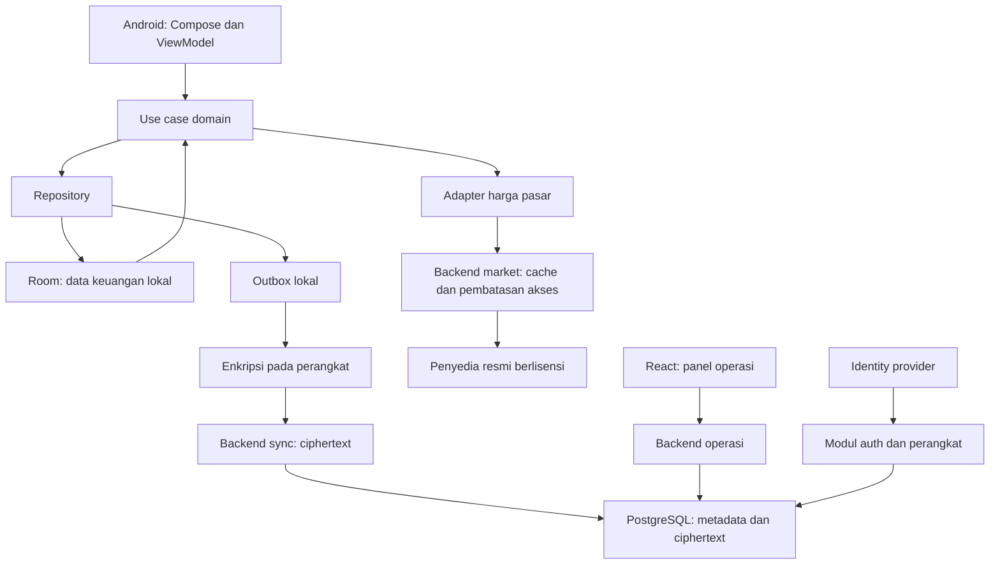
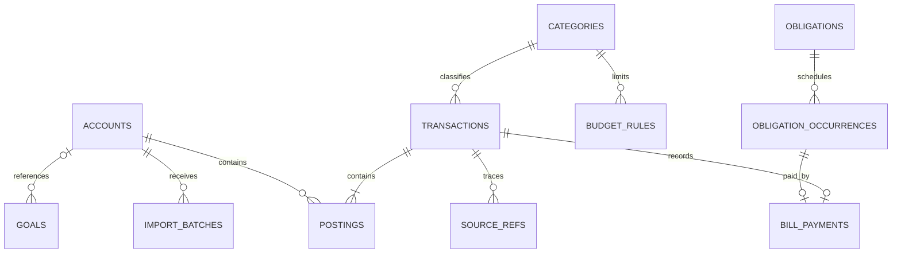

# FinTrack — Arsitektur dan rancangan data

Tanggal rencana: 31 Oktober 2026. Status: usulan untuk implementasi, belum merupakan verifikasi kode atau hasil build.

## 1. Keputusan awal dan sumber kebenaran

Dokumen FinTrack menyatakan sudah ada aplikasi Kotlin/Jetpack Compose, Room, pencatatan transaksi, transfer, anggaran, target, tagihan, simulasi 90 hari, CSV, dan harga kripto. Lampiran tidak memuat proyek Android, tetapi pengguna kemudian memberikan repository Reliaaaa/FinTrack. Inventaris source, README, TEST_RESULTS.md dan konfigurasi app/build.gradle.kts telah diperiksa pada commit aaa94566182b167918f87789f2ef9e830ebc393b. Ini pemeriksaan baseline terbatas; perilaku tiap fitur tetap wajib diaudit dan diuji pada M0. HTML dalam ZIP adalah referensi desain; contoh kode di spesifikasi bukan aplikasi yang telah dibuktikan berjalan.

| Persoalan | Keputusan usulan | Alasan dan batas |
|---|---|---|
| Kotlin versus React Native | Android memakai Kotlin + Jetpack Compose | Sesuai fokus Android dan fondasi yang disebut dokumen terbaru. Tidak membangun ulang dengan dua framework mobile sekaligus. |
| Peran React | React + TypeScript untuk panel operasional web, bila dibutuhkan | Panel hanya melihat kesehatan layanan, konfigurasi, dan metadata dukungan; bukan isi keuangan pengguna. Web konsumen merupakan keputusan produk terpisah. |
| Backend | Node.js + TypeScript; satu aplikasi dengan modul jelas | Mempermudah perubahan kontrak dan deploy awal. Auth, market, sync, dan operasi memiliki batas modul; belum memerlukan microservices. |
| Database di dalam aplikasi | Room di atas SQLite sebagai sumber data yang dibaca UI | Catat, edit, laporan, anggaran, dan simulasi tetap berfungsi tanpa internet. |
| Database server | PostgreSQL untuk akun cloud, perangkat, versi sync, dan metadata operasi | Tidak menggandakan ledger keuangan dalam bentuk terbaca server jika mode E2EE dipilih. |
| Cloud | Opsional; ditambahkan setelah integritas lokal dan pemulihan terbukti | Pengguna lokal tidak dipaksa membuat akun. Login cloud dan membuka kunci aplikasi adalah fungsi berbeda. |
| Skala | Ukur beban nyata lalu tingkatkan kapasitas | Target 10 juta MAU, <100 ms, dan 99,99% dalam spesifikasi belum didukung pengujian. Kubernetes, Kafka, sharding, Redis Cluster, serta ClickHouse tidak menjadi syarat MVP. |
| Nama/package | FinTrack; `id.fintrack.app` terkonfirmasi pada konfigurasi source | Pergantian package ID dapat memutus upgrade. Jangan mengganti identitas aplikasi yang sudah didistribusikan tanpa rencana migrasi. |

Konfigurasi source saat ini menggunakan Java 17, compileSdk/targetSdk 35 dan minSdk 26. Pertahankan toolchain baseline untuk reproduksi; evaluasi pembaruan melalui tugas terpisah. Versi Node dan dependency backend belum dipilih karena backend belum menjadi implementasi yang diaudit. Syarat distribusi terbaru diperiksa saat rilis.

## 2. Komponen dan aliran data



Alur lokal didahulukan: UI mengirim perintah ke use case; use case memvalidasi dan menjalankan transaksi database; UI mengamati hasil lokal. Akses jaringan tidak berada di jalur wajib penyimpanan transaksi. Pola ini mengikuti pedoman Android mengenai sumber lokal untuk aplikasi offline-first. [Android: offline-first](https://developer.android.com/topic/architecture/data-layer/offline-first)

M1 dapat dirilis tanpa backend akun. M0/M1 boleh membangun service skeleton, health endpoint, konfigurasi, dan pipeline staging untuk membuktikan fondasi fullstack. Modul pasar dapat berjalan lebih dahulu apabila hak akses penyedia sudah jelas. Modul sync baru aktif di M3 dan melalui pilihan pengguna.

## 3. Struktur aktual dan target bertahap

Saat ini Android berada di root (`app/`, `gradle/`, `gradlew`, `settings.gradle.kts`). Pertahankan posisi tersebut untuk paket planning. Pohon berikut adalah opsi target jangka panjang, bukan instruksi langsung memindahkan file. Services dapat ditambahkan sebagai saudara `app/`; migrasi ke `apps/android/` memerlukan ADR, penyesuaian workflow dan build ulang yang terpisah.

```text
fintrack/
  apps/
    android/
      app/                       # entry point, navigasi, DI
      core/
        domain/                  # Money, ledger rules, forecast
        database/                # Room, DAO, migrations, schema exports
        data/                    # repository, adapters
        network/                 # API client, DTO mapping
        crypto/                  # key lifecycle, backup, envelopes
        designsystem/            # tokens, shared Compose components
        testing/                 # synthetic fixtures and test helpers
      feature/
        onboarding/ accounts/ transactions/ dashboard/
        budgets/ goals/ obligations/ forecast/ reports/
        portfolio/ importexport/ settings/
        capture/                 # M2: notification, OCR, PDF
        sync/                    # M3
      gradle/                    # wrapper and version catalog
    admin-web/                   # optional React operational UI
  services/
    api/
      src/modules/
        health/ auth/ devices/ market/ sync/ operations/
      db/migrations/
      tests/
  contracts/
    openapi/                     # reviewed HTTP contracts
    schemas/                     # backup and encrypted payload schemas
    fixtures/                    # shared semantic test vectors
  docs/
    adr/ design/ product/ security/ runbooks/
  infra/                         # environment configuration and IaC
  .github/workflows/
```

Jangan memecah setiap fitur menjadi modul Gradle sejak hari pertama jika source lama masih kecil. Directory boundaries dapat diterapkan dulu; pemisahan build module mengikuti kebutuhan isolasi dan waktu build. Domain murni Kotlin tidak bergantung pada Compose, HTTP, atau Room. React tidak mengimpor entity database Android; berbagi kontrak dan fixture, bukan mengandalkan satu model runtime lintas bahasa.

## 4. Model data lokal

Target skema baru mengusulkan UUID yang dibuat di perangkat; baseline memiliki ID integer sehingga perlu pemetaan ID lama-ke-baru yang persisten dan rekonsiliasi saat migrasi. Entitas target memiliki waktu perubahan audit; versi lokal; dan status penghapusan bila akan disinkronkan. Data lokal memiliki `vault_id` sebagai ruang kepemilikan, sekalipun awalnya satu vault per instalasi. Ini tidak otomatis membuat fitur banyak pengguna.

| Entitas | Kolom penting | Aturan utama |
|---|---|---|
| `accounts` | id, vault_id, name, type, currency, opening_balance_minor, is_liquid, archived_at | M1 hanya IDR; arsipkan rekening yang sudah memiliki transaksi. Saldo diturunkan dari saldo awal dan posting, bukan input bebas yang dapat berbeda dari riwayat. |
| `categories` | id, vault_id, name, kind, icon, archived_at | Kategori bawaan memakai ID stabil; mengarsipkan kategori tidak menghapus transaksi. |
| `transactions` | id, vault_id, kind, effective_date, occurred_at, zone_id, category_id, note, source, status, revision | Satu transaksi logis; `kind` INCOME/EXPENSE/TRANSFER/ADJUSTMENT. Hanya CONFIRMED memengaruhi saldo. |
| `postings` | id, transaction_id, account_id, signed_amount_minor | Pendapatan satu posting positif; pengeluaran satu posting negatif; transfer dua posting berlawanan. Ini ledger rekening pribadi, bukan klaim double-entry accounting lengkap. |
| `capture_drafts` | id, source, source_key, candidate_payload, parser_version, state | Notifikasi/OCR/PDF menghasilkan draf; konfirmasi baru membuat transaksi. Payload sensitif dibatasi retensinya. |
| `import_batches` | id, account_id, file_digest, parser_version, imported_at, result_counts | Simpan ringkasan dan identitas impor; berkas asli tidak wajib disimpan. |
| `source_refs` | vault_id, account_id, source, external_ref, fingerprint, transaction_id | Identitas pasti dideduplikasi; kemiripan nominal/tanggal saja meminta tinjauan, sebab dua transaksi identik dapat sah. |
| `budget_rules` | id, category_id, amount_minor, effective_from_month, effective_to_month | Satu aturan berlaku untuk satu kategori pada rentang bulan tertentu; perubahan tidak menulis ulang anggaran historis. |
| `goals` | id, name, target_minor, tracked_progress_minor, target_date, optional_account_id | Progres bukan saldo baru; tidak ditambahkan lagi ke kekayaan bersih. |
| `obligations` | id, name, kind, amount_minor, due_day, start_month, installment_count, active | Jadwal; `installment_count` null berarti berulang. Sisa pembayaran diturunkan dari occurrence yang lunas. |
| `obligation_occurrences` | id, obligation_id, period, due_date, due_amount_minor, status | Unik per kewajiban dan periode. Status dapat PENDING/PAID/SKIPPED; pembayaran dan pembatalan punya jejak. |
| `bill_payments` | id, occurrence_id, transaction_id, paid_minor | M1 satu pelunasan penuh per occurrence; pembayaran parsial ditunda agar aturan tidak ambigu. |
| `holdings` | id, asset_class, symbol, quantity_decimal, cost_minor, price_decimal, quote_currency, quoted_at, price_source | Jumlah saham berunit lembar dan emas gram. Harga desimal dipertahankan sebelum valuasi rupiah. |
| `market_quotes` | provider, symbol, price_decimal, observed_at, fetched_at | Cache publik; sumber, waktu, dan status stale terlihat di UI. |
| `settings` | vault_id, payroll_day, monthly_income_minor, zone_id, privacy_settings | Pengaturan nonrahasia; key/token tidak disimpan sebagai teks biasa di tabel ini. |
| `outbox` | mutation_id, aggregate_id, base_revision, payload_version, state, retry_at | Ditulis atomik bersama perubahan domain saat cloud diaktifkan; tidak mengantre tanpa batas untuk pengguna lokal. |
| `sync_state` | vault_id, server_cursor, key_version, last_success_at | Cursor hanya maju sesudah seluruh halaman masuk berhasil disimpan lokal. |
| `conflicts` | aggregate_id, base_version, local_version, remote_version, resolution | Semua isi finansial hanya ada secara terbaca di perangkat. |



Skema ini merupakan target pengembangan. Audit source menentukan apakah struktur dua-baris-transfer lama dipertahankan sementara atau dimigrasikan menjadi transaction header + postings. Migrasi tersebut harus eksplisit, bukan mengganti tabel tanpa transformasi dan rekonsiliasi.

## 5. Nilai uang, tanggal, indeks, dan invariant

**Uang.** IDR transaksi menggunakan integer 64-bit rupiah, bukan Float/Double. Tentukan batas bisnis di bawah batas penyimpanan dan tolak overflow sebelum penjumlahan. JSON mengirim nilai uang sebagai string digit agar JavaScript tidak kehilangan presisi integer besar. Unit dan harga aset memakai desimal tetap, misalnya maksimum 18 digit pecahan dengan batas total digit yang terdokumentasi; Kotlin menggunakan BigDecimal dan SQLite menyimpan bentuk string kanonik. Perkalian dilakukan secara desimal, lalu valuasi rupiah dibulatkan dengan aturan HALF_UP; batas aman belanja dibulatkan ke bawah dan kebutuhan setoran ke atas. Harga di bawah Rp1 tetap bisa disimpan. Data numerik publik yang memang disimpan backend menggunakan NUMERIC berskala eksplisit, bukan floating point; PostgreSQL membedakan numeric eksak dari floating point tak eksak. [PostgreSQL: numeric types](https://www.postgresql.org/docs/current/datatype-numeric.html)

**Tanggal.** `effective_date` adalah tanggal kalender transaksi yang menentukan laporan; tidak dihitung ulang dari zona perangkat setelah pindah negara. `occurred_at` opsional berupa waktu UTC untuk notifikasi/impor dengan timestamp; simpan `zone_id` asal. Tanggal gajian/jatuh tempo yang tidak ada pada suatu bulan dijepit ke hari terakhir. Transaksi aktual masa depan ditolak; rencana masa depan berada pada jadwal/simulasi. Persetujuan PM dibutuhkan untuk mengubah asumsi dokumen lama bahwa gaji hari ini sudah masuk saldo.

**Indeks minimum.** Indeks pada `(vault_id,effective_date,id)`, posting `(account_id,transaction_id)`, transaksi `(category_id,effective_date)`, occurrence unik `(obligation_id,period)`, source ref unik `(vault_id,account_id,source,external_ref)` untuk referensi yang tersedia, serta outbox `(state,retry_at)`. Fingerprint heuristik bukan unique constraint global yang dapat membuang dua pembelian sah. Primary/foreign key dan CHECK menjaga bentuk nilai; aturan lintas baris dipastikan use case dalam satu transaksi database dan diuji.

**Invariant yang menjadi syarat merge:**

1. Saldo rekening = saldo awal + total posting CONFIRMED yang tidak dibatalkan. Cache saldo jika diperlukan harus diperbarui atomik dan dapat dibangun ulang.
2. Transfer memiliki dua rekening berbeda dan dua posting dengan jumlah nol; total aset tidak berubah. Transfer tidak ikut jumlah pendapatan/pengeluaran. Biaya transfer merupakan pengeluaran terpisah yang ditautkan.
3. Edit/hapus memperbarui semua posting dan relasi terkait dalam satu transaksi. Tidak boleh ada transfer separuh, tagihan lunas tanpa transaksi, atau saldo baru dengan riwayat lama.
4. Goal progress tidak menciptakan uang. Portofolio manual tidak otomatis memotong rekening kecuali kelak ada alur pembelian aset yang eksplisit.
5. Menekan simpan dua kali dengan operation ID sama menghasilkan satu perubahan. Import ulang dengan referensi sumber sama tidak menggandakan posting.
6. Anggaran menghitung EXPENSE saja; transfer dan draft dikecualikan. Riwayat anggaran tidak berubah karena pengguna mengubah batas bulan berikutnya.
7. Total utang berbasis angsuran pada dokumen lama harus diberi nama “sisa komitmen pembayaran”; jangan menamakannya pokok pinjaman tanpa data pokok.

Contoh pelunasan M1: pilih occurrence → pilih rekening → validasi → buat EXPENSE + posting → buat bill_payment → tandai PAID → enqueue mutation bila cloud aktif → commit. Pembatalan menjalankan invers seluruh operasi dan mengembalikan status PENDING. Satu operation ID dipakai selama retry.

## 6. Backend dan kontrak HTTP

Kontrak berikut adalah rancangan, belum endpoint yang tersedia. HTTP hanya melalui TLS. Error konsisten berupa code, pesan aman, dan request ID; body pribadi tidak dicetak di log.

| Area | Kontrak usulan | Ketentuan |
|---|---|---|
| Health | `GET /health/live`, `GET /health/ready` | Liveness tidak bergantung pada layanan eksternal; readiness memeriksa dependensi wajib tanpa mengungkap rahasia. |
| Identity | OIDC Authorization Code + PKCE melalui browser sistem; `GET /v1/me` | Gunakan penyedia identitas yang dipilih pada M0/M3. Jangan membuat password auth sendiri sebagai default. API memverifikasi issuer, audience, signature, expiry, serta sesi perangkat. |
| Devices | `GET/DELETE /v1/devices/{id}` sesuai bentuk resource final | Pengguna hanya mengelola perangkatnya sendiri; pencabutan menghentikan sesi dan sync berikutnya. Pencabutan tidak dapat menghapus salinan plaintext yang sudah ada di perangkat offline. |
| Market | `GET /v1/market/quotes?symbols=...`, `GET /v1/market/candles?...` | Allowlist provider/simbol, batas ukuran/periode, timeout, cache, attribution, timestamp; tidak menerima arbitrary URL. |
| Sync push | `POST /v1/sync/batches` | mutation_id, opaque aggregate_id, base_revision, key_version, payload_version, encrypted payload, nonce dan authentication tag. Kepemilikan vault ditentukan auth, bukan dipercaya dari body. |
| Sync pull | `GET /v1/sync/changes?after=...&limit=...` | Cursor stabil dari server, pagination berbatas, perubahan dan tombstone; respons tidak memuat data keuangan terbuka. |
| Backup metadata | `GET/POST /v1/backups` pada M3 | Hanya metadata minimal dan blob terenkripsi. Presigned URL jika dipakai terbatas pada pengguna, ukuran, metode, dan masa berlaku. |
| Account deletion | `POST /v1/account-deletion` | Autentikasi ulang, status pekerjaan, penghapusan sesi/blob aktif, jadwal retensi backup yang dijelaskan ke pengguna. |
| Admin | `/v1/ops/*` | Role terpisah, autentikasi kuat, audit; tidak menyediakan endpoint “lihat transaksi pengguna” di mode E2EE. |

Tidak ada endpoint server untuk saldo, anggaran pribadi, atau rekomendasi finansial dari ledger plaintext dalam rancangan E2EE. Analytics finansial dan forecast dihitung lokal. Jika kelak bisnis menginginkan analitik server, hal itu adalah perubahan arsitektur privasi yang harus dijelaskan dan dipilih pengguna; tidak boleh diam-diam melemahkan E2EE.

PostgreSQL menyimpan `cloud_users`, `devices`, `vaults`, `vault_memberships` satu pemilik pada tahap awal, `sync_aggregates`, `sync_changes`, `idempotency_records`, `encrypted_backups`, `deletion_jobs`, dan `ops_audit_events`. Gunakan constraint kepemilikan, ID unik, serta indeks `(vault_id,server_sequence)`; transaksi server mengikat penerimaan mutation, perubahan revision, dan log perubahan. Server mengenali ukuran, waktu, perangkat, dan identitas cloud; E2EE tidak menyembunyikan seluruh metadata tersebut.

## 7. Sinkronisasi tanpa kehilangan transaksi

1. Pada aktivasi cloud, buat encrypted baseline dan catat cursor. Pengguna memverifikasi recovery kit sebelum sync dinyatakan siap.
2. Setiap perubahan lokal menyimpan domain dan outbox dalam transaksi yang sama. Gunakan logical aggregate utuh untuk transfer dan pelunasan, sehingga pasangan posting tidak terpisah dalam sync.
3. Worker mengirim mutation dengan operation ID tetap. Backend menyimpan hasil idempotency; retry respons yang hilang mengembalikan hasil yang sama.
4. Backend menerapkan compare-and-swap terhadap `base_revision` dan mengembalikan revision baru. Batch atomik hanya untuk perubahan yang memang saling bergantung; batas ukuran batch ditetapkan kontrak.
5. Jika dua perangkat mengedit aggregate sama, kirim konflik 409 dan revision remote. Perangkat mendekripsi kedua versi dan menampilkan pilihan penyelesaian. Jangan menjumlahkan dua saldo atau menimpa transaksi finansial hanya berdasarkan waktu jam perangkat.
6. Perubahan pada aggregate berbeda bisa digabung. Setelah apply, hitung ulang saldo dan anggaran lokal dari posting. Saldo lokal yang tertunda ditandai bila ada konflik relevan.
7. Delete adalah tombstone berversi. Mutation dari perangkat lama tidak menghidupkan data terhapus; pemulihan membutuhkan perintah eksplisit dengan revision terbaru. Retensi tombstone dan batas perangkat offline ditetapkan sebelum M3; setelah melewati batas, perangkat wajib full resync yang mempertahankan dan meninjau outbox lokal sebelum mengganti snapshot.
8. Saat vault dipulihkan dari backup lama, buat identitas restore epoch dan rekonsiliasi secara eksplisit; jangan mengunggah snapshot lama sebagai jutaan edit terbaru.

WorkManager menjadi kandidat penjadwal pekerjaan sync persisten; scheduling mengikuti kondisi perangkat dan tidak dijanjikan real-time. Push bila dipakai hanya membawa sinyal “ada perubahan”, tidak nominal atau isi catatan. Model conflict/idempotency di atas adalah keputusan desain FinTrack, bukan kemampuan otomatis Room.

## 8. Enkripsi, kunci, cadangan, dan pemulihan

**Lokal.** Ruang privat aplikasi bukan pengganti enkripsi database. Pilih library SQLite terenkripsi yang kompatibel dengan Room setelah audit dependency dan benchmark; database key acak dibungkus dengan key perangkat di Android Keystore. Kunci aplikasi menggunakan autentikasi perangkat/biometrik, dengan kebijakan relock, lock-screen redaction, dan fallback yang diuji. Keystore memungkinkan pembatasan penggunaan key dan mencegah ekspor material key tertentu; ini tidak berarti semua data otomatis terenkripsi atau perangkat yang sedang terbuka kebal kompromi. [Android Keystore](https://developer.android.com/privacy-and-security/keystore)

**E2EE cloud.** Gunakan primitive AEAD dari library teruji; algoritme, nonce uniqueness, associated data, dan key version ditetapkan melalui review Security. Associated data mengikat vault, aggregate, payload schema, dan versi untuk menolak pertukaran envelope. Jangan menulis algoritme kriptografi sendiri. Data encryption key dapat dibungkus untuk setiap perangkat yang disetujui dan recovery key. Login cloud saja tidak boleh cukup untuk membuka isi vault.

**Pemulihan key.** Key Keystore perangkat tidak dianggap dapat dipindah ke ponsel baru. Recovery kit dibuat di sisi klien, diperlihatkan sekali dengan verifikasi pengguna, dan tidak dikirim terbuka ke server/log. Jika menggunakan passphrase, perlu KDF teruji, salt, parameter versi, dan pengujian batas perangkat. Reset password akun tidak dapat memulihkan vault E2EE tanpa perangkat tepercaya atau recovery kit. Pengguna harus mengetahui batas ini sebelum aktivasi, bukan saat kehilangan ponsel.

**Backup M1.** Ekspor cadangan lengkap harus memuat rekening, posting, kategori, jadwal/occurrence/pembayaran, target, aset, serta pengaturan penting. Manifest menyimpan format/schema version dan checksum; archive dienkripsi dan diautentikasi. CSV tetap fitur interoperabilitas, bukan backup lengkap. Rahasia sesi, key perangkat, dan kredensial provider tidak diekspor mentah.

**Restore M1.** Baca manifest → batasi ukuran/jumlah entri → verifikasi dan dekripsi → import ke database sementara → cek FK, invariant, hitung ulang saldo → tampilkan ringkasan → ganti database secara atomik dengan recovery journal. Cadangan salah password/rusak tidak mengubah database aktif. Uji proses mati dan ruang disk habis di setiap titik kritis. Jangan menyalin database SQLite aktif tanpa mekanisme snapshot yang konsisten terhadap WAL.

**Migrasi.** Commit schema export dan migration untuk setiap perubahan. Uji upgrade dari seluruh versi yang didukung menggunakan data sintetis yang mencakup transfer, tagihan lunas, duplikat impor, dan nominal besar; bandingkan saldo sebelum/sesudah. Jangan menggunakan destructive fallback pada data produksi. Android mendokumentasikan migrasi Room sebagai cara mempertahankan data saat skema berubah. [Room migrations](https://developer.android.com/training/data-storage/room/migrating-db-versions)

## 9. Kapasitas, observabilitas, dan batas operasi

Ukuran awal yang perlu diuji: 10.000 transaksi lokal, 100 rekening, dan proyeksi 90 hari pada perangkat Android kelas menengah. Ini fixture perencanaan, bukan klaim kapasitas final. Pisahkan waktu UI, waktu query, dan waktu jaringan. Ukur p95 baca dashboard dan simpan transaksi, crash-free sessions, migration success, restore success, serta kegagalan sync; jangan mengirim catatan atau nominal sebagai label telemetry.

Backend pertama menggunakan deployment sederhana dan managed PostgreSQL dengan backup teruji. RPO/RTO ditentukan bersama anggaran hosting dan diuji melalui restore staging. Tambahkan cache terdistribusi hanya setelah cache per-instance tidak cukup; pecah service ketika ada bukti kebutuhan isolasi beban/kepemilikan, bukan karena diagram referensi menyebut skala besar.

## 10. Syarat selesai pekerjaan Architect dan Database

- ADR diterima Tech Lead: pilihan stack, batas local/cloud, model uang/tanggal, ledger, E2EE, konflik sync, dan key recovery.
- Source pada M0 berhasil dipetakan terhadap klaim dokumen; setiap perbedaan menjadi issue dengan dampak migrasi dan pengguna.
- Skema beserta constraint/index, kontrak API, dan fixture domain direview Mobile/Backend, Database, QA, serta Security sebelum feature PR bergantung padanya.
- Transfer, edit/hapus, pelunasan/pembatalan, impor idempotent, migration, dan restore lolos invariant tests; hasil mencantumkan commit, perangkat/runtime, serta log yang relevan.
- Tidak ada perubahan database produksi tanpa jalur upgrade dan prosedur pemulihan yang sudah dicoba di staging. Rollback aplikasi memperhitungkan kompatibilitas skema; mengembalikan binary saja tidak selalu aman.
- Target distribusi dan versi dependency diputuskan setelah repository dan environment tersedia. Dokumen ini tidak menyatakan build atau deploy sudah terjadi.

Rujukan teknis di atas dibaca pada 31 Oktober 2026. Klaim fungsi FinTrack berasal dari lampiran pengguna; keputusan tambahan pada dokumen ini merupakan usulan arsitektur untuk direview.
